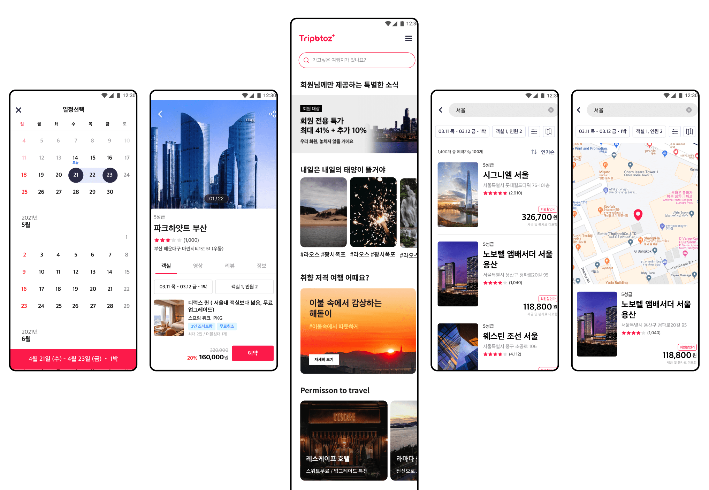

<figure style="display: block; margin: 0 auto; text-align: center">

<figcaption></figcaption>
</figure>

## Key Achievements
- Refactored the entire website responsive and made mobile webViews in React, Webpack, Babel, Styled Components

- Reduced 25% of customer service cases by optimizing map and hotel commerce page browser renderings through reconstructing backend-to-frontend API data flow and enhancing asynchronous event handling system

- Led UI engineering of design components based on atomic modular system, designing UX wireframes for designers

## Skills

Babel.js · Cascading Style Sheets (CSS) · React.js · JavaScript · HTML · Node.js · Redux.js · Webpack

## 𝐏𝐫𝐨𝐣𝐞𝐜𝐭: 𝐑𝐞𝐬𝐩𝐨𝐧𝐬𝐢𝐯𝐞 𝐰𝐞𝐛𝐬𝐢𝐭𝐞𝐬 (𝐒𝐏𝐀), 𝐦𝐨𝐛𝐢𝐥𝐞 𝐰𝐞𝐛𝐯𝐢𝐞𝐰𝐬 𝐟𝐨𝐫 𝐀𝐧𝐝𝐫𝐨𝐢𝐝/𝐢𝐎𝐒 𝐚𝐩𝐩𝐬
- Improved redux data flow and asynchronous event handling system in order to optimize browser rendering, especially for Map pages

- Upgraded an outdated website into mobile/tablet/PC responsive web app with React, Redux, Reselect structure

- Manage CI/CD, troubleshoot, and deploy with Jenkins 

## 𝐁𝐮𝐢𝐥𝐝 𝐃𝐞𝐬𝐢𝐠𝐧 𝐒𝐲𝐬𝐭𝐞𝐦, 𝐋𝐞𝐚𝐝 𝐏𝐫𝐨𝐝𝐮𝐜𝐭 𝐌𝐚𝐧𝐚𝐠𝐞𝐦𝐞𝐧𝐭
- Refactored UI engineering by modularizing all components and building Design System based on atomic design philosophy. Worked closely with UX designers

- Led a product management process for new features - developing social media sharing, integrating common components. Worked closely with design, sales, CS teams.

- Improve UI/UX based on customer / internal feedbacks in every weekly sprint cycle

## 𝐏𝐫𝐨𝐣𝐞𝐜𝐭: 𝐇𝐨𝐭𝐞𝐥 𝐑𝐞𝐯𝐞𝐧𝐮𝐞 𝐌𝐚𝐧𝐚𝐠𝐞𝐦𝐞𝐧𝐭 𝐒𝐨𝐥𝐮𝐭𝐢𝐨𝐧𝐬 (𝐁𝟐𝐁)
- Plan and build the early stage website with React framework, Ant design, AWS S3, cloudfront

- Integrate i18n for internationalization/localization
